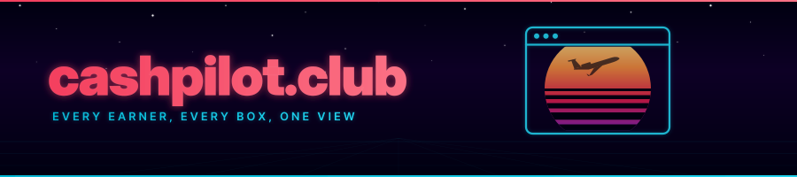

<p align="center">
  
</p>

<h1 align="center">cashpilot.club</h1>

<p align="center">
  <a href="https://github.com/GeiserX/CashPilot-web/actions/workflows/pages.yml"></a>
  <a href="https://github.com/GeiserX/CashPilot-web/actions/workflows/ci.yml"></a>
  <a href="LICENSE"></a>
</p>

The website of [CashPilot](https://github.com/GeiserX/CashPilot): a landing page, downloads for every system, the referral disclosure, privacy and disclaimer pages. Static, dark only, no cookies, no analytics, and no request to any other host at runtime.

## Build

Needs Bun 1.3 and Node 22.23 or newer.

```sh
bun install
bun run build          # type check, then build to dist/
bun run preview        # serve dist/ the way GitHub Pages does
```

The build reads live data from GitHub and Docker Hub: the service catalog, star counts, Docker pulls, release versions, file sizes and checksums. Set `GITHUB_TOKEN` to avoid the API rate limit. Locally, any part it cannot fetch comes from `src/data/snapshot.json`, so the build also works offline. In CI (`CI` set) a part that cannot be fetched fails the build, so the last good deploy stays live. `CASHPILOT_OFFLINE=1` skips the network. `bun run data:snapshot` refreshes the snapshot.

Download buttons point at the release tags pinned in `src/data/pins.json`, so the version, sizes and checksums on the page always match the file. `.github/workflows/bump-pins.yml` checks every hour for new CashPilot, Desktop and Android releases. When one is out and every file the site links for it answers HTTP 200, it opens a PR that moves the pin. A release with a missing file is not pinned, and the run fails with the file named. `bun scripts/bump-pins.ts --dry-run` runs the same check locally.

### Checks

```sh
bun run i18n:check     # placeholder and HTML mismatches; --strict: no missing keys; --all: all 20 files
bun run screenshots    # full-page shots at 1440 and 390 px into screenshots/; fails on any third-party request
bun run a11y           # axe-core WCAG 2.2 AA on every page; fails on any violation
bun run overflow       # fails when a page scrolls sideways, from 320 to 1440 px
```

`screenshots` and `a11y` need a Playwright Chromium (`bunx playwright install chromium`) and a build in `dist/`.

## Languages

Every visible string lives in `src/i18n/<locale>.json`, with the same keys as `en.json`. `en.json` is frozen: translators add locale files only. The 20 locales are listed in `src/i18n/locales.ts`. A locale is built when its file exists, at `/<locale>/` (English at `/`). A key missing from a locale shows in English, and `i18n:check` lists it. Keep `{placeholders}`, HTML tags and link targets exactly as in English: the check fails otherwise.

The picker shows once a second locale exists. It remembers the choice in `localStorage` only. On the first visit to an English page, a small inline script sends the visitor to the best match for the browser's languages (`es-MX` gets `es`, `pt-PT` gets `pt-BR`). After that, a stored choice wins and the browser language is only suggested. Bots, visitors without JavaScript and browsers that block storage get English.

Service strings from the catalog (the bonus and the minimum payout) are translated in CashPilot's `services/_i18n/<locale>.yml` and read at build time with the catalog. A translation whose source hash no longer matches the English string, or that drops a referral code the English names, shows English.

## Layout

| Path | What |
| --- | --- |
| `src/pages/[...locale]/` | The pages, generated once per locale |
| `src/components/` | Header, footer, download panels, frames, small parts |
| `src/data/` | Build-time data fetcher and the offline snapshot |
| `src/lib/links.ts` | Every outside URL |
| `src/assets/shots/` | Product screenshots, cropped by `scripts/prepare-images.ts` |
| `public/` | `CNAME`, favicon, link preview image (`scripts/make-og.ts`) |

## Deploy

`.github/workflows/pages.yml` builds and deploys to GitHub Pages on every push to `main`, once a day and on demand. The custom domain is `cashpilot.club` (`public/CNAME`).

A sibling release workflow can send a `release` repository dispatch (`event_type: release`, a token with `repo` scope) to start the bump check at once instead of at the next hour. GitHub turns off scheduled workflows after 60 days without a commit here; re-enable them in the Actions tab.

## Rules for content

- No earnings figure stated as typical.
- A referral note next to every block of provider links, and every referral link listed on `/referrals/`.
- No personal data about anyone. Credit "CashPilot contributors".
- No trackers, cookies, newsletters or third-party requests.

## License

[GPL-3.0-or-later](LICENSE). CashPilot contributors.
