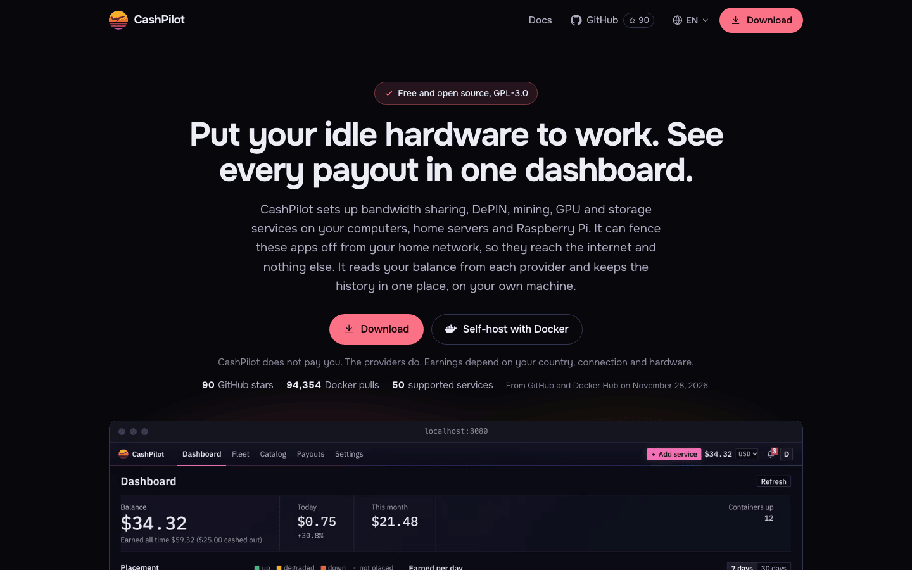

# Home hero: five proposals

## The problem

The hero is the first screen of https://cashpilot.club. Today it is a wall of centred text:

- The lead is one paragraph of 55 words in three sentences. It covers setup, the network fence, balance reading and local history at once. At 1440 px it fills five centred lines.
- The pill, the title, the lead, the buttons and the proof all have nearly the same weight. The eye has no clear path.
- The disclaimer and the stats row are small grey lines under the buttons. They look like leftovers, not like proof.
- At 1440 px only the top 236 px of the product shot is on the first screen.

A visitor should know in five seconds what CashPilot is, why to trust it, and what to click.



## The designs

Every mockup is the real built home page with only the hero swapped. The navbar and every section below the hero are byte-identical to the live site. Each folder has a `NOTES.md` with the full copy key by key, the checks that ran and an implementation plan.

| # | Direction | New lead | Best for | Cost | Judges |
| --- | --- | --- | --- | --- | --- |
| **0-recommended** | 2-split, plus the best ideas of the other three. Every defect that the judges found is fixed. | "CashPilot sets up bandwidth sharing, DePIN, mining, GPU and storage apps on the computers you already own, and tracks what each one pays you." (24 words) | Showing the product before a word is read | High. About 440 lines of CSS replace about 145. 4 new keys and 2 rewritten keys. A build check fails when the screenshot changes. | built after judging |
| 2-split | Words on the left and a large dashboard on the right. Three labels point at real parts of the screenshot. | "CashPilot runs bandwidth sharing, DePIN, mining and GPU apps on the computers you already own, and tracks what each one pays you." (22 words) | The same, first draft | High. About 375 lines of CSS and 3 new keys. | 24 |
| 1-tight | Today's centred layout, cut hard. A one-line title, one sentence, three points in a band and badges for the numbers. | "CashPilot runs earning apps on your own machines and shows every payout in one dashboard." (15 words) | The smallest change from today | Low. About 30 lines of markup, 6 new keys and 3 rewritten keys. | 22.5 |
| 4-steps | Three steps on one rail (install, pick, watch), then the buttons and a trust bar. | "CashPilot runs bandwidth sharing, DePIN, mining, GPU and storage services on your own machines." (15 words) | Visitors who want to know how it works before they click | Medium. About 80 lines of CSS, 5 new keys, 3 changed keys, and the pill goes. | 18 |
| 3-motion | Centred. The hardware word in the title cycles, and a band of the 50 service names moves. | "CashPilot runs bandwidth sharing, DePIN, mining, GPU and storage apps on the machines you already own, and shows every payout in one dashboard." (23 words) | A livelier first screen | Medium. About 195 lines of CSS, no JavaScript and 11 new keys. The motion needs a pause button. | 17 |

The judge totals come from three judges who scored each first draft. 0-recommended was built after that pass, so it has no score of its own.

## Recommendation: 0-recommended

- It shows the product first. The dashboard sits next to the words, large enough to read, and the whole hero fits on the first screen at 1440 and 1024 px. The platforms strip starts inside the first screen.
- It starts from the design the judges scored highest (2-split, 24) and fixes every defect they listed. The claims no longer cover the screenshot, the fence claim says "can", and no marker points at a dollar figure.
- The lead drops from 55 words to 24 and keeps all five service groups. The fence and the local history become three short claims under the window. On a phone they move up under the lead, so they are on the first screen.
- The disclaimer sits right under the buttons with an info icon, in a stronger colour. The numbers become a real proof block with their source date.

If the cost matters more than the result, 1-tight is the cheap option. It keeps today's layout and still fixes the wall of text.

## What happens next

These mockups are a proposal. Reply on the PR with the number you want. The same PR then:

1. Implements that design in `src/pages/[...locale]/index.astro`.
2. Adds and rewrites its keys in all 20 files in `src/i18n/`.
3. Passes `bun run i18n:check --strict --all`, `bun run build`, `bun run a11y` and `bun run overflow`.
4. Deletes `design/`.

## How the mockups render

Astro builds only `src/` and `public/`, so `design/` is never published. A build with this folder present gives 221 pages and no file from `design/` in `dist/`.

The build assets (`_astro/`, `favicon.svg`, `apple-touch-icon.png`, `og.png`) are not committed. They are about 2.2 MB per folder. To render a mockup from `file://`:

```sh
git worktree add ../cashpilot-web-f3ed12a f3ed12a
(cd ../cashpilot-web-f3ed12a && bun install --frozen-lockfile && bun run build)
sh design/home-hero/restore-assets.sh ../cashpilot-web-f3ed12a/dist
```

Run the build on a build box, not a laptop. The asset file names are content hashes, so a build of f3ed12a gives the names each `index.html` expects.

The script copies the assets into all six folders and makes the font paths relative. On the MacMini, the six restored pages render byte-identical to the shots taken with the original assets.

Each folder holds `index.html`, the shots and `NOTES.md`. `shot-<width>.png` is the full page and `top-<width>.png` is the first 900 px. `base/` is today's page. All shots were rendered on a build box at 1440, 1024 and 390 px.
